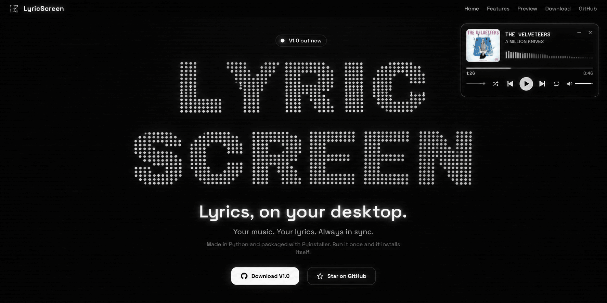
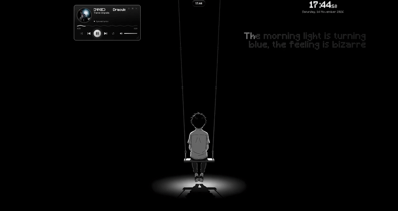
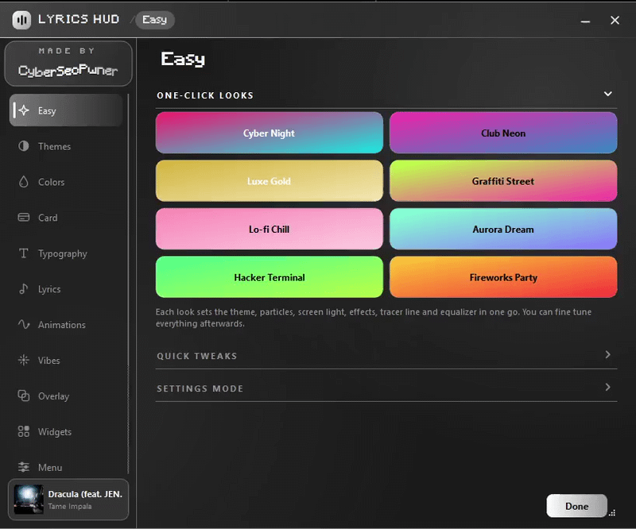

<p align="center">
  
</p>

<h1 align="center">LyricScreen</h1>

<h3 align="center">Lyrics, on your desktop.</h3>

<p align="center">
  <b>Your music. Your lyrics. Always in sync.</b><br>
  Synced lyrics and a music player for Windows. Run it once and it installs itself.
</p>

<p align="center">
  <a href="https://github.com/CyberSecPwnerrr/LyricScreen/releases"></a>
  <a href="https://lyricscreen.netlify.app"></a>
  <a href="https://github.com/CyberSecPwnerrr/LyricScreen"></a>
  <a href="https://ko-fi.com/cybersecpwner"></a>
</p>

<p align="center">
  
  
  
  
  
  
  
</p>

<p align="center">
  <a href="#hear-it-read-it">Preview</a> &nbsp;/&nbsp;
  <a href="#everything-on-your-screen">Features</a> &nbsp;/&nbsp;
  <a href="#one-click-ready-to-use">Install</a> &nbsp;/&nbsp;
  <a href="#how-it-works">How it works</a> &nbsp;/&nbsp;
  <a href="#controls">Controls</a> &nbsp;/&nbsp;
  <a href="#settings">Settings</a> &nbsp;/&nbsp;
  <a href="#faq">FAQ</a> &nbsp;/&nbsp;
  <a href="#troubleshooting">Troubleshooting</a>
</p>


LyricScreen puts synced lyrics and a music player on your Windows desktop. Use a compact **player card**, a **floating lyrics overlay**, or both together, then change the colors, animations and position until it fits your setup.

It reads what is playing from the Windows media session, so it works with **Spotify, YouTube Music, browser players** and anything else that reports to Windows. Lyrics come from [LRCLIB](https://lrclib.net).

<table align="center">
  <tr>
    <td align="center"><b>Free</b><br><sub>No account, no paywall</sub></td>
    <td align="center"><b>Open source</b><br><sub>Code is on GitHub</sub></td>
    <td align="center"><b>One file</b><br><sub>Run once, it installs itself</sub></td>
    <td align="center"><b>Private</b><br><sub>Your data stays on your PC</sub></td>
  </tr>
</table>


## Hear it. Read it.

The website has a live preview of the lyrics view: **[lyricscreen.netlify.app](https://lyricscreen.netlify.app)**

Play the demo song or paste a YouTube link. It finds the track, fetches synced lyrics from LRCLIB and follows the music line by line. The preview has two lyric modes:

| Mode | What it does |
|---|---|
| **Box Lyrics** | Keeps the lyrics inside the player window. |
| **Screen Lyrics** | Drops the box and shows one line at a time, moving around your whole screen. |

<p align="center">
  
  <br>
  <sub><b>Live preview.</b> Synced lyrics follow the music in real time.</sub>
</p>

<p align="center">
  
  <br>
  <sub><b>Menu tour.</b> Explore the app's controls and customization options.</sub>
</p>


## Everything on your screen.

Lyrics in front of you while you listen, work or play.

| Feature | What you get |
|---|---|
| **Synced lyrics** | Timed lyrics with current line highlighting, anticipation and per-track timing offsets. |
| **Player card** | Album art, track info, progress, volume, playback status and an equalizer. |
| **Floating lyrics** | Lyrics above your windows or on the wallpaper layer, placed anywhere. |
| **Live clock** | A draggable clock with its own date, format, size, opacity and background. |
| **Themes** | Cyber Neon, Frosted Glass, Aurora, Synthwave, Midnight, Sakura, Ember, Emerald, Crystal and more. |
| **Customization** | Colors, gradients, fonts, blur, transparency, borders, shadows, glow and card layout. |
| **Animation and effects** | Lyric transitions, scanlines, glitch, flicker and 3D tilt. |
| **Multiple monitors** | Pick which screen shows the floating lyrics. |
| **Quick controls** | Tray menu, global hotkeys and Quick Customize. |
| **Profiles and share codes** | Save a setup and share it with a code. |
| **Extras** | Google Fonts search, launch audio, a welcome screen and update checks. |
| **Free and open source** | No account, no paywall. The code is here on GitHub. |

### Display modes

<table>
  <tr>
    <td width="50%" valign="top">
      <b>Player card</b><br>
      Album art, track info, progress, volume and visualizer in one card.
    </td>
    <td width="50%" valign="top">
      <b>Floating lyrics</b><br>
      A standalone overlay with its own position, size, colors and animation.
    </td>
  </tr>
  <tr>
    <td width="50%" valign="top">
      <b>Card and floating lyrics</b><br>
      Both at once, each customized separately.
    </td>
    <td width="50%" valign="top">
      <b>Live clock</b><br>
      An optional clock that follows your theme.
    </td>
  </tr>
</table>

### Works with

| Source | Supported |
|---|---|
| Spotify | Yes |
| YouTube Music | Yes |
| Browser players | Yes, may need hardware media controls on |
| Any player that reports to the Windows media session | Yes |


## One click. Ready to use.

LyricScreen is written in Python and packaged with PyInstaller into a single executable. There is no setup wizard and nothing else to install.

| Step | What to do |
|---|---|
| **1. Download** | Get the `.exe` from the [latest release](https://github.com/CyberSecPwnerrr/LyricScreen/releases). |
| **2. Run it once** | On first launch it installs itself into Program Files and adds a shortcut to your desktop. |
| **3. Play music** | Start a song and the synced lyrics appear. Open it any time from the desktop shortcut. |

### Download it via command? No problem.

Copy one of these (Ctrl + C), press **Win + R**, paste it in (Ctrl + V) and press **Enter**. It downloads the latest release to your Downloads folder and opens the folder.

<details>
<summary><b>CMD</b></summary>

```bat
cmd /c powershell -c "$ProgressPreference=0;$a=(irm https://api.github.com/repos/CyberSecPwnerrr/LyricScreen/releases/latest).assets|?{$_.name -like '*.exe'}|select -f 1;iwr $a.browser_download_url -OutFile $HOME\Downloads\LyricScreen.exe;ii $HOME\Downloads"
```

</details>

<details>
<summary><b>PowerShell</b></summary>

```powershell
powershell -c "$ProgressPreference=0;$a=(irm https://api.github.com/repos/CyberSecPwnerrr/LyricScreen/releases/latest).assets|?{$_.name -like '*.exe'}|select -f 1;iwr $a.browser_download_url -OutFile $HOME\Downloads\LyricScreen.exe;ii $HOME\Downloads"
```

</details>

### Run from source

Needs Windows 10 or 11 and Python 3.9 or newer.

```bash
git clone https://github.com/CyberSecPwnerrr/LyricScreen.git
cd LyricScreen
python lyrics_hud.py
```

On first launch from source it checks for and installs the Python packages it needs.

### Under the hood

| | |
|---|---|
| **Language** | Python |
| **Interface** | PyQt6 |
| **Media detection** | Windows media session via WinRT for Python |
| **Lyrics** | Synced lyrics from LRCLIB |
| **Packaging** | PyInstaller, one executable file |
| **Installation** | Copies itself into Program Files on first start. No separate installer. |
| **Shortcut** | Created on your desktop automatically |
| **Platform** | Windows 10 and 11 |
| **Source** | Open on GitHub |
| **Price** | Free, no account |

### Compatibility

Playback is detected through the Windows media session API, so the player has to report its current media to Windows. Browser players may need hardware media controls turned on.

A track only shows lyrics if LRCLIB has a synced entry for it.


## How it works

```
  Your player                Windows                 LyricScreen                 Your screen
 ┌────────────┐   reports   ┌───────────────┐  reads ┌──────────────────┐  draws ┌────────────────┐
 │ Spotify,   │ ──────────► │ Media session │ ─────► │ Title, artist,   │ ─────► │ Player card    │
 │ browser... │             │               │        │ position         │        │ Floating lyrics│
 └────────────┘             └───────────────┘        └────────┬─────────┘        │ Clock          │
                                                              │ looks up         └────────────────┘
                                                              ▼
                                                     ┌──────────────────┐
                                                     │ LRCLIB           │
                                                     │ synced lyrics    │
                                                     │ (cached locally) │
                                                     └──────────────────┘
```

1. Your player tells Windows what is playing.
2. LyricScreen reads the title, artist and playback position from the Windows media session.
3. It looks up synced lyrics on LRCLIB and caches them on your PC.
4. It follows the playback position and highlights the current line, applying your per-track timing offset.


## Controls

### Mouse

| Action | Result |
|---|---|
| Click the progress bar | Seek through the track |
| Scroll over the player card | Change the volume |
| Right-click the player card | Open the quick menu |
| Click the tray icon | Show or hide the HUD |
| Drag the clock | Move the clock |

### Global hotkeys

The default modifier is `Ctrl + Alt + Shift`. Hotkeys can be turned off in Settings.

| Shortcut | Action |
|---|---|
| `Ctrl + Alt + Shift + J` | Lyrics 100 ms earlier |
| `Ctrl + Alt + Shift + K` | Lyrics 100 ms later |
| `Ctrl + Alt + Shift + H` | Reset lyric timing |
| `Ctrl + Alt + Shift + N` | Snap the current line to playback |
| `Ctrl + Alt + Shift + V` | Show or hide the HUD |

The tray menu also has playback, display mode, sync and position controls.


## Settings

Open **Settings** from the tray menu.

<details>
<summary><b>Appearance</b></summary>

Themes, colors, gradients, card styles, blur, opacity, borders, shadows and glow.

</details>

<details>
<summary><b>Lyrics</b></summary>

Font, size, spacing, highlighting, anticipation, timing and placement.

</details>

<details>
<summary><b>Animation</b></summary>

Entry and exit styles, idle motion, effects and frame rate limits.

</details>

<details>
<summary><b>Player card</b></summary>

Layout, album art, track details, volume, equalizer and background.

</details>

<details>
<summary><b>Overlay</b></summary>

Display layer, monitor, lyric size, width and wallpaper dimming.

</details>

<details>
<summary><b>Clock</b></summary>

Time format, date, size, opacity and background.

</details>

<details>
<summary><b>Profiles and share codes</b></summary>

Save and load named setups, or export and import settings that do not depend on local files.

Share codes do not include custom images, downloaded fonts or launch audio. Select those again on the other computer.

</details>


## Your data

Everything stays on your PC, in `%APPDATA%\LyricsHUD\`.

| Path | What it holds |
|---|---|
| `config.json` | Your settings |
| `track_offsets.json` | Lyric timing per track |
| `cache/` | Cached lyrics |
| `profiles/` | Saved profiles |
| `Font/` | Fonts the app can use |

It only goes online to look up lyrics that are not cached, and for Google Fonts search and downloads. There is no account and no sign-in.


## FAQ

<details>
<summary><b>Is LyricScreen really free?</b></summary>

Yes. No account, no paywall, and the code is open on GitHub.

</details>

<details>
<summary><b>Which music apps work?</b></summary>

Anything that reports its current media to the Windows media session, including Spotify, YouTube Music and browser players.

</details>

<details>
<summary><b>Where do the lyrics come from?</b></summary>

From [LRCLIB](https://lrclib.net). If it has no synced entry for a track, no lyrics are shown.

</details>

<details>
<summary><b>Does it need an installer?</b></summary>

No. Run the `.exe` once and it installs itself into Program Files and adds a desktop shortcut.

</details>

<details>
<summary><b>Can I move the lyrics to another monitor?</b></summary>

Yes. Pick the screen for the floating lyrics in the Overlay settings.

</details>

<details>
<summary><b>Can I share my setup with a friend?</b></summary>

Yes. Export a share code in Settings and send it. Custom images, fonts and launch audio are not included, so they need to be selected again.

</details>

<details>
<summary><b>Does it collect my data?</b></summary>

No. Settings, cache and profiles stay in `%APPDATA%\LyricsHUD\`. It only goes online for lyrics lookups and Google Fonts.

</details>


## Troubleshooting

<details>
<summary><b>No lyrics appear</b></summary>

- Check that LRCLIB has synced lyrics for the track.
- Check that the detected title and artist are right.
- Make sure you are online if the lyrics are not cached yet.

</details>

<details>
<summary><b>No music is detected</b></summary>

- Check that the player shows up in the Windows volume flyout.
- If you use a browser, turn on hardware media controls.
- Pause and play the track to refresh its media session.

</details>

<details>
<summary><b>Lyrics are out of sync</b></summary>

- Press `Ctrl + Alt + Shift + J` or `K` to nudge the timing.
- Use the snap shortcut to line up the current line.
- Reset the offset if it gets worse.

</details>

<details>
<summary><b>The player card or clock is off screen</b></summary>

- Use the reset position actions in the tray menu or the clock settings.

</details>

<details>
<summary><b>A custom image, font or sound is missing</b></summary>

- Check that the file is still at the path you picked. Share codes do not carry local files.

</details>

<details>
<summary><b>It will not launch</b></summary>

- From source, run `python lyrics_hud.py` in a terminal to see the error.
- With the executable, check Windows Security and make sure it came from the official Releases page.

</details>


## Follow the journey.

LyricScreen is built in the open by CyberSecPwner. Every update, idea and release lands on GitHub first. If you like it, leave a star. Feedback and suggestions are welcome on Discord: **Umonkstudios**.

<p align="center">
  <a href="https://github.com/CyberSecPwnerrr"></a>
  <a href="https://www.tiktok.com/@cybersecpwner"></a>
  
  <a href="https://lyricscreen.netlify.app"></a>
</p>

<p align="center">
  <a href="https://star-history.com/#CyberSecPwnerrr/LyricScreen&Date">
    
  </a>
</p>

## Support the project

LyricScreen is free and always will be. If it made your desktop better and you want to help keep updates coming, you can buy me a coffee.

<p align="center">
  <a href="https://ko-fi.com/cybersecpwner"></a>
</p>

Starring the repo and sharing it with friends helps just as much.

## Credits

| Project | Used for |
|---|---|
| [LRCLIB](https://lrclib.net) | Synced lyrics |
| [PyQt6](https://pypi.org/project/PyQt6/) | The interface |
| [WinRT for Python](https://pypi.org/project/winrt-runtime/) | Windows Runtime access |
| [PyInstaller](https://pyinstaller.org/) | Single-file packaging |
| [Google Fonts](https://fonts.google.com/) | Fonts |


<h2 align="center">V10 is out now.</h2>

<p align="center">
  Free, forever. Windows. Run it once and it is installed.<br><br>
  <a href="https://github.com/CyberSecPwnerrr/LyricScreen/releases"><b>Download from GitHub</b></a>
  &nbsp;&nbsp;/&nbsp;&nbsp;
  <a href="https://lyricscreen.netlify.app">lyricscreen.netlify.app</a>
  &nbsp;&nbsp;/&nbsp;&nbsp;
  <a href="https://ko-fi.com/cybersecpwner">Support on Ko-fi</a>
</p>

<p align="center">
  <sub>Made by <a href="https://github.com/CyberSecPwnerrr">CyberSecPwner</a></sub>
</p>
